<div align="center">

<a href="https://animatedwebs.com">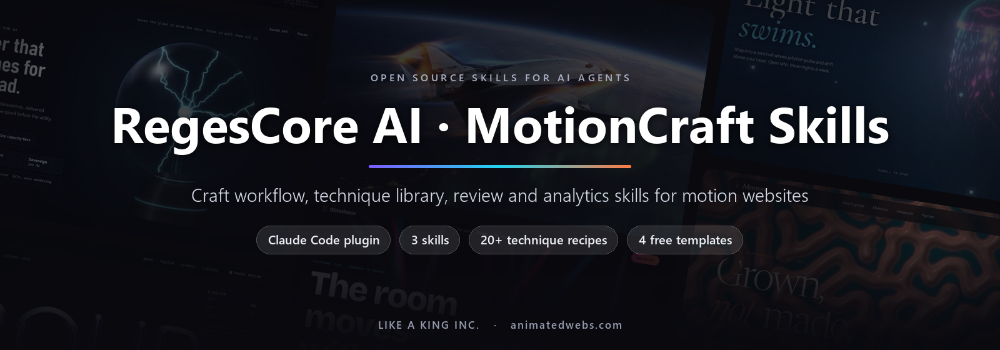</a>

# RegesCore AI · MotionCraft Skills

**Teach your AI agent to build, review and measure cinematic motion websites, the way small studios ship award work.**

[](LICENSE)
[](#install)
[](#what-is-inside)
[](#four-free-templates)
[](https://animatedwebs.com/mcp)
[](https://threejs.org)
[](#faq)

[Install](#install) · [What is inside](#what-is-inside) · [Techniques](#technique-sampler) · [Free templates](#four-free-templates) · [Tools](#tools) · [Gallery](#made-with-motioncraft) · [FAQ](#faq) · [Ecosystem](#the-like-a-king-inc-ecosystem)

</div>

---

## Why this exists

Ask an AI agent for an "animated website" and you usually get a gradient, three fade-ins and a carousel. The sites that win awards are built differently. They start from one idea taken from the customer's own world, they are planned shot by shot before any code, the motion is proven in grey boxes, and then someone looks hard at the result on a phone and fixes what is wrong.

MotionCraft puts that process into your agent as three [Agent Skills](https://docs.claude.com/en/docs/claude-code/skills):

- **motioncraft-builder** turns a brief into one idea, a page architecture, a beat sheet and a grey-boxed mechanic, then dresses it with tested technique recipes.
- **motion-review** screenshots every section at desktop and phone sizes, scores the page on a 10-point rubric and runs 12 blocking QA checks.
- **motion-analytics** measures frame time at p50 and p95, sets weight budgets, adds a quality ladder for weak phones and grades a page fairly against a reference.

Every rule comes with numbers, not adjectives. Every snippet is vanilla JavaScript with three.js 0.170 from an import map, so it runs without a build step. Every page keeps real HTML underneath, a visible pause control and a full reduced-motion branch.

This is the same craft we use to ship the motion templates on [AnimatedWebs](https://animatedwebs.com). We are sharing the method, the checks and four complete templates so you can build your own.

## Install

### Claude Code (plugin)

Run these two commands inside Claude Code:

```text
/plugin marketplace add iboss21/regescore-motioncraft-skills
/plugin install motioncraft@regescore-motioncraft
```

That is it. Claude loads the right skill on its own when the task fits, for example:

> Build a scroll story for Cinderford Coffee Roasters where one bean travels through the roast.
>
> Review ./site for phone issues and tell me what blocks shipping.
>
> This hero stutters on my phone. Measure it and fix the worst cause.

You can also call a skill by name: `/motioncraft:motioncraft-builder`, `/motioncraft:motion-review`, `/motioncraft:motion-analytics`.

### Codex, Cursor and any other agent (manual copy)

A skill is a plain folder with a `SKILL.md` file and its references. Copy the folders wherever your agent reads instructions.

```bash
git clone https://github.com/iboss21/regescore-motioncraft-skills.git
cd regescore-motioncraft-skills

# Claude Code without the plugin system (personal skills)
cp -r plugins/motioncraft/skills/* ~/.claude/skills/

# Codex (personal skills folder)
mkdir -p ~/.codex/skills && cp -r plugins/motioncraft/skills/* ~/.codex/skills/

# Cursor, Windsurf, Antigravity or any agent: keep the skills in your project
mkdir -p .agents/skills && cp -r plugins/motioncraft/skills/* .agents/skills/
```

On Windows PowerShell, use `Copy-Item -Recurse plugins\motioncraft\skills\* $HOME\.claude\skills\` (or the folder your agent uses).

When your agent does not discover skills on its own, add one line to your `AGENTS.md`, `.cursorrules` or project rules:

```text
Before any motion, WebGL or scroll-story work, read .agents/skills/motioncraft-builder/SKILL.md and follow it. Before calling a page done, run .agents/skills/motion-review/SKILL.md.
```

### Requirements for the scripts

The skills themselves are text. `frame-meter.js` runs in the browser. The three Node scripts need **Node 18 or newer**, and the screenshot and QA scripts also need Playwright in the project you review:

```bash
npm i -D playwright && npx playwright install chromium
npm i -D sharp   # optional, for contact sheets
```

## What is inside

```text
regescore-motioncraft-skills/
├── .claude-plugin/marketplace.json        marketplace "regescore-motioncraft"
├── plugins/motioncraft/
│   ├── .claude-plugin/plugin.json         plugin "motioncraft"
│   └── skills/
│       ├── motioncraft-builder/           craft workflow and technique library
│       │   ├── SKILL.md
│       │   └── references/
│       │       ├── craft-rules.md
│       │       ├── beat-sheet.md
│       │       ├── page-architecture.md
│       │       └── techniques/            INDEX.md + five recipe files
│       ├── motion-review/                 rubric, QA checklist, screenshot and QA scripts
│       │   ├── SKILL.md
│       │   ├── references/                rubric.md, qa-checklist.md
│       │   └── scripts/                   section-shots.mjs, qa-lite.mjs
│       └── motion-analytics/              performance budgets and reference grading
│           ├── SKILL.md
│           ├── references/                performance.md, reference-grading.md
│           └── scripts/                   frame-meter.js, compare-sheet.mjs
├── templates/                             four free, complete motion templates
├── tools/README.md                        AnimatedWebs MCP, Tools and Designer
└── docs/                                  ecosystem map and screenshots
```

### 1. motioncraft-builder

The craft workflow in seven steps: **find the one idea**, **choose a page architecture**, **write the beat sheet**, **grey-box the mechanic**, **dress it**, **look and fix**, **ship**. Each step has an output you can show a client before moving on, and a grey-box starter (import map, fixed canvas, section-centered scroll value, shot list with smoothstep holds) that runs as is.

| Reference | What it gives you |
|---|---|
| [SKILL.md](plugins/motioncraft/skills/motioncraft-builder/SKILL.md) | The seven-step workflow, the grey-box starter and the non-negotiables |
| [craft-rules.md](plugins/motioncraft/skills/motioncraft-builder/references/craft-rules.md) | 30 numbered rules with concrete values: idea, planning, timing, restraint, film and sound, access |
| [beat-sheet.md](plugins/motioncraft/skills/motioncraft-builder/references/beat-sheet.md) | The beat sheet template plus a fully worked example for a fictional coffee roaster |
| [page-architecture.md](plugins/motioncraft/skills/motioncraft-builder/references/page-architecture.md) | Nav archetypes, hero compositions, section types, footers, 404s and a sameness check |
| [techniques/INDEX.md](plugins/motioncraft/skills/motioncraft-builder/references/techniques/INDEX.md) | 26 recipes by need, wow, effort and cost, with combinations that work together |

### 2. motion-review

A look-and-fix loop: **shoot, look, check, score, fix the worst thing, repeat**. The bar is a rubric average of 8 or higher, no criterion under 7, and every blocking check passing at 1440x900 and 390x844.

| Reference or script | What it gives you |
|---|---|
| [SKILL.md](plugins/motioncraft/skills/motion-review/SKILL.md) | The loop, the `?shot=N` hook, the report format and rules of thumb |
| [rubric.md](plugins/motioncraft/skills/motion-review/references/rubric.md) | 10 criteria scored 1 to 10, with what a 5, an 8 and a 10 look like |
| [qa-checklist.md](plugins/motioncraft/skills/motion-review/references/qa-checklist.md) | 12 blocking checks with how each is measured and the usual fix |
| [section-shots.mjs](plugins/motioncraft/skills/motion-review/scripts/section-shots.mjs) | Screenshots every section at desktop and phone sizes, plus contact sheets |
| [qa-lite.mjs](plugins/motioncraft/skills/motion-review/scripts/qa-lite.mjs) | PASS or FAIL per blocking check with measured numbers, exit code 1 on any FAIL |

The 12 blocking checks: console errors, horizontal overflow, reversible scroll, pause control for continuous motion, reduced motion, phone text at least 11 px, tap targets at least 44 px, no white flash, fonts loaded, alt text and accessible names, focus states, page weight budget.

### 3. motion-analytics

Motion quality is measurable. This skill turns "feels smooth" and "looks close" into numbers you can repeat next week.

| Reference or script | What it gives you |
|---|---|
| [SKILL.md](plugins/motioncraft/skills/motion-analytics/SKILL.md) | Targets, the measure and fix workflow, and the report format |
| [performance.md](plugins/motioncraft/skills/motion-analytics/references/performance.md) | Frame-time budget, a rolling quality ladder, DPR caps, texture and page weight budgets, Web Vitals and a fix table |
| [reference-grading.md](plugins/motioncraft/skills/motion-analytics/references/reference-grading.md) | Four matched moments, fair capture of timed films, three independent graders, verdicts and pitfalls |
| [frame-meter.js](plugins/motioncraft/skills/motion-analytics/scripts/frame-meter.js) | Drop-in frame-time meter: p50, p95, p99, long frames and a suggested quality tier |
| [compare-sheet.mjs](plugins/motioncraft/skills/motion-analytics/scripts/compare-sheet.mjs) | Side-by-side grading sheet from two screenshot folders, with an optional blind mode |

### Scripts at a glance

| Script | Run it like this | Output |
|---|---|---|
| `section-shots.mjs` | `node section-shots.mjs ./site 6 ./qa/shots` | `d0.png` to `d5.png`, `p0.png` to `p5.png`, contact sheets |
| `qa-lite.mjs` | `node qa-lite.mjs ./site --json qa.json` | PASS or FAIL per check, JSON report, exit code for CI |
| `frame-meter.js` | `<script src="frame-meter.js" defer></script>`, open with `?meter` | Live readout, `frameMeter.report()` in the console |
| `compare-sheet.mjs` | `node compare-sheet.mjs ./ours ./reference ./compare --blind` | `compare.html` with a verdict form, `compare.png`, `key.json` |

Each script lives in its skill's `scripts/` folder. With the plugin, Claude Code tells the agent where that folder is when the skill loads, so just ask for a review. After a manual copy, call a script by its full path from your project, for example `node ~/.claude/skills/motion-review/scripts/qa-lite.mjs ./site`. The three Node scripts print their options when run without arguments.

## Technique sampler

A taste of the 26 recipes. Each one has what it is, when to use it, premium parameter values, a compact working snippet, phone notes, reduced-motion notes and its cost.

| Recipe | What it gives you | Cost |
|---|---|---|
| [R02 Shot list with smoothstep holds](plugins/motioncraft/skills/motioncraft-builder/references/techniques/scroll-and-camera.md#r02-shot-list-with-smoothstep-holds) | A camera that rests on each section and travels between them | Free |
| [R03 Phone framing with setViewOffset](plugins/motioncraft/skills/motioncraft-builder/references/techniques/scroll-and-camera.md#r03-phone-framing-with-setviewoffset) | The subject sits above the copy on portrait screens, no second scene | Free |
| [R05 Mode value: one scroll range changes the world](plugins/motioncraft/skills/motioncraft-builder/references/techniques/scroll-and-camera.md#r05-mode-value-one-scroll-range-changes-the-world) | Night to paper, raw to finished, today to the plan | Low |
| [R07 Morph-target tube morph](plugins/motioncraft/skills/motioncraft-builder/references/techniques/scene-craft.md#r07-morph-target-tube-morph-3d-route-to-flat-diagram) | A 3D route that flattens into its own diagram | Low |
| [R12 Exploded view from one value](plugins/motioncraft/skills/motioncraft-builder/references/techniques/scene-craft.md#r12-exploded-view-from-one-value) | Show what is inside a product, driven by scroll | Free |
| [R16 Tracked hotspot over a cover-fit video](plugins/motioncraft/skills/motioncraft-builder/references/techniques/film-and-photo.md#r16-tracked-hotspot-over-a-cover-fit-video) | Spec cards pinned inside footage at any crop | Low |
| [R17 Depth-photo parallax](plugins/motioncraft/skills/motioncraft-builder/references/techniques/film-and-photo.md#r17-depth-photo-parallax) | A photograph that becomes a small 3D set | Medium |
| [R18 Synthesized drum voice set](plugins/motioncraft/skills/motioncraft-builder/references/techniques/sound-and-rhythm.md#r18-synthesized-drum-voice-set) | Kick, snare, hat and clap with zero audio bytes | Free |
| [R24 Hold-to-trigger gate](plugins/motioncraft/skills/motioncraft-builder/references/techniques/interaction-and-access.md#r24-hold-to-trigger-gate) | One climactic action in the customer's own verb | Free |
| [R26 Quality ladder and loop hygiene](plugins/motioncraft/skills/motioncraft-builder/references/techniques/interaction-and-access.md#r26-quality-ladder-and-loop-hygiene) | The same story on weak hardware, no wasted frames | Free |

Browse all of them in the [technique index](plugins/motioncraft/skills/motioncraft-builder/references/techniques/INDEX.md).

## Four free templates

Complete, single-folder motion templates you can open, read and ship. Each one is plain HTML, CSS and JavaScript, has a pause control and a composed reduced-motion still, and passes all 12 blocking checks of `qa-lite.mjs` at desktop and phone sizes. Click a screenshot for the live demo.

<table>
<tr>
<td width="50%" valign="top">
<a href="https://animatedwebs.com/demos/starlane-synthwave-terrain/">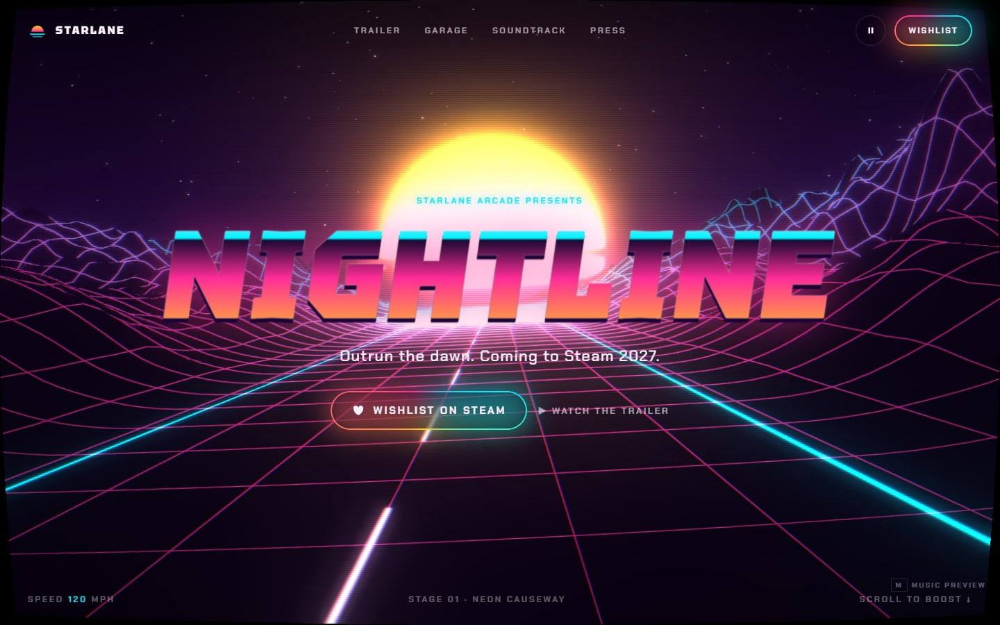</a>
<br><b>Starlane · Synthwave Terrain Racer</b>
<br>An endless neon wireframe landscape rushes toward a striped sunset, for a retro racing game launch.
<br><a href="https://animatedwebs.com/demos/starlane-synthwave-terrain/">Live demo</a> · <a href="https://animatedwebs.com/templates/starlane-synthwave-terrain">Template page</a> · <a href="templates/starlane-synthwave-terrain/">Source</a>
</td>
<td width="50%" valign="top">
<a href="https://animatedwebs.com/demos/keyline-command-palette-home/">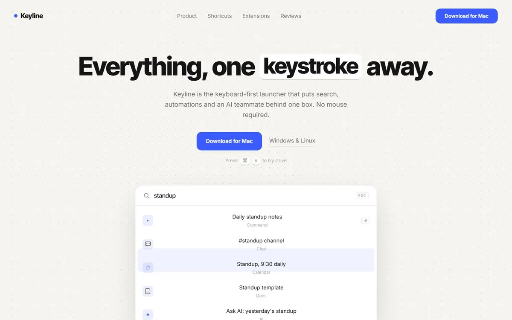</a>
<br><b>Keyline · Command Palette Productivity</b>
<br>A live Cmd+K palette types its own queries and filters results right in the hero.
<br><a href="https://animatedwebs.com/demos/keyline-command-palette-home/">Live demo</a> · <a href="https://animatedwebs.com/templates/keyline-command-palette-home">Template page</a> · <a href="templates/keyline-command-palette-home/">Source</a>
</td>
</tr>
<tr>
<td width="50%" valign="top">
<a href="https://animatedwebs.com/demos/aurel-liquid-chrome-audio/">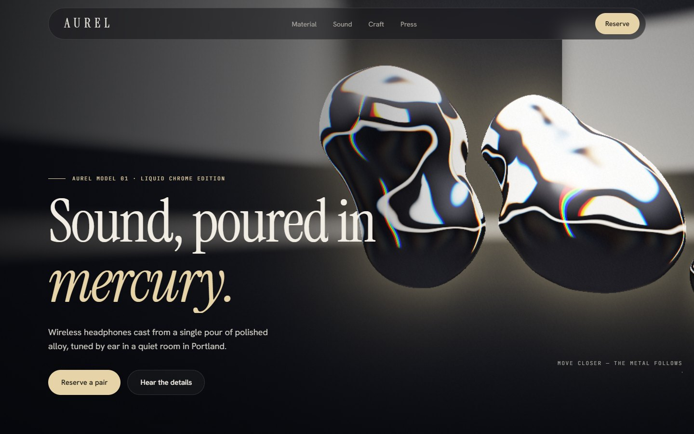</a>
<br><b>Aurel · Liquid Chrome Audio</b>
<br>Raymarched mercury blobs merge, split and chase the cursor above a luxury headphone launch.
<br><a href="https://animatedwebs.com/demos/aurel-liquid-chrome-audio/">Live demo</a> · <a href="https://animatedwebs.com/templates/aurel-liquid-chrome-audio">Template page</a> · <a href="templates/aurel-liquid-chrome-audio/">Source</a>
</td>
<td width="50%" valign="top">
<a href="https://animatedwebs.com/demos/mycel-physarum-network/"></a>
<br><b>Mycel · Physarum Routing Network</b>
<br>A GPU slime mold simulation grows glowing routes between logistics hubs, and visitors can feed it or plant new hubs.
<br><a href="https://animatedwebs.com/demos/mycel-physarum-network/">Live demo</a> · <a href="https://animatedwebs.com/templates/mycel-physarum-network">Template page</a> · <a href="templates/mycel-physarum-network/">Source</a>
</td>
</tr>
</table>

Each template is a single `index.html`: serve the folder with any static server (`python -m http.server 8080`) and open it. Rendering, libraries and weight for each one are in [templates/README.md](templates/README.md).

Run the review script on one yourself, from the repo root:

```bash
npm i -D playwright && npx playwright install chromium
node plugins/motioncraft/skills/motion-review/scripts/qa-lite.mjs templates/keyline-command-palette-home
```

The templates are free for personal and commercial sites, including client work, under their own license, separate from the MIT license on the skills. You may not resell or redistribute them as templates. Read [templates/LICENSE.md](templates/LICENSE.md) before you ship one.

## Tools

The skills work on their own. These tools from the same team make them faster: real template prompts inside your editor, ready three.js components and a design workspace.

| Tool | What it does |
|---|---|
| [AnimatedWebs](https://animatedwebs.com) | 1,500+ motion website templates with live demos and build prompts |
| [Templates](https://animatedwebs.com/templates) | Browse by industry, style and kind. Play every demo before you pick |
| [AnimatedWebs MCP](https://animatedwebs.com/mcp) | Search templates, UI components, cinematic backgrounds and style references from Claude Code, Cursor, Codex, VS Code and more |
| [AnimatedWebs Tools](https://tools.animatedwebs.com) | three.js hero components, interactive shaders and prompts with variants you can tune, framework agnostic |
| [AnimatedWebs Designer](https://design.animatedwebs.com) | Your private design workspace with AnimatedWebs AI, reachable from your editor through its own MCP |
| [AnimatedWebs for Claude Code](https://github.com/iboss21/animatedwebs-claude) | The official Claude Code plugin: the MCP plus site, hero and browse commands |

Add the MCP to Claude Code with one command. The first call opens your browser to sign in, so there is no key to paste:

```bash
claude mcp add --transport http animatedwebs https://mcp.animatedwebs.com
```

Setup for every other editor is in [tools/README.md](tools/README.md).

**Better together.** MotionCraft teaches the process and checks the result. The MCP hands your agent a proven starting point. A good loop: pull a template prompt with the MCP, plan it with `motioncraft-builder`, then run `motion-review` and `motion-analytics` before you call it done.

## Made with MotionCraft

Live templates on AnimatedWebs built with the same workflow, rules and review loop. Click any frame to open it.

<table>
<tr>
<td width="33%" valign="top"><a href="https://animatedwebs.com/templates/keelbill-canopy-hostel">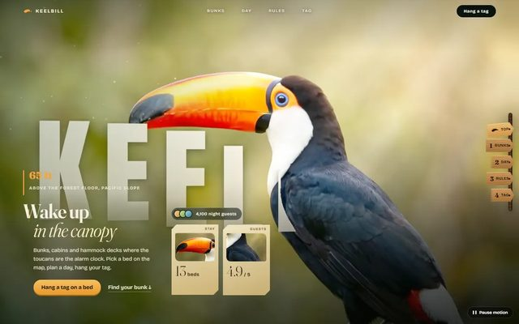</a><br><b>Keelbill</b> · a toucan lands as the canopy opens</td>
<td width="33%" valign="top"><a href="https://animatedwebs.com/templates/sabrewing-telehealth">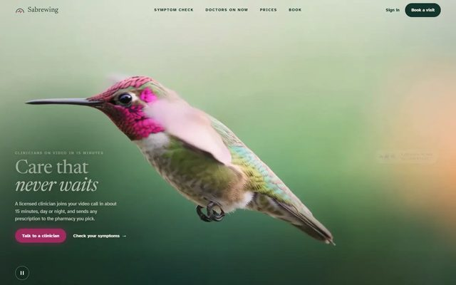</a><br><b>Sabrewing</b> · a hummingbird hovers and the page breathes</td>
<td width="33%" valign="top"><a href="https://animatedwebs.com/templates/openfloor-vr-tours">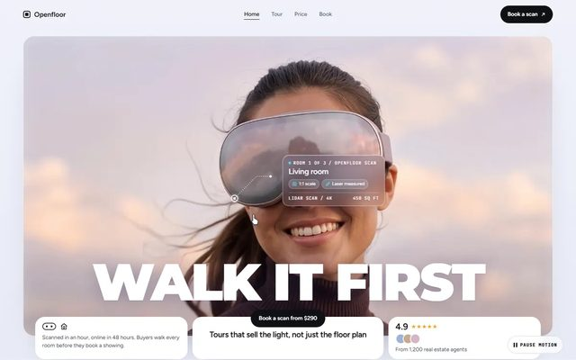</a><br><b>Openfloor</b> · a VR headset loop and a walkable floor plan</td>
</tr>
<tr>
<td width="33%" valign="top"><a href="https://animatedwebs.com/templates/lumeria-jellyfish-aquarium">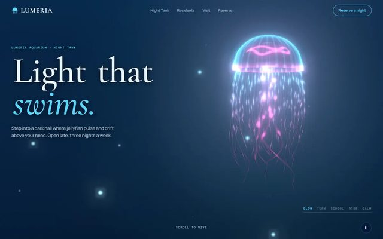</a><br><b>Lumeria</b> · a 3D jellyfish turns over and rises on scroll</td>
<td width="33%" valign="top"><a href="https://animatedwebs.com/templates/kelvane-plasma-globe-grid">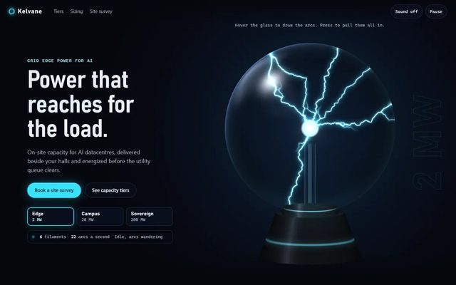</a><br><b>Kelvane</b> · plasma arcs reach for your hand</td>
<td width="33%" valign="top"><a href="https://animatedwebs.com/templates/morrow-reaction-diffusion-lab">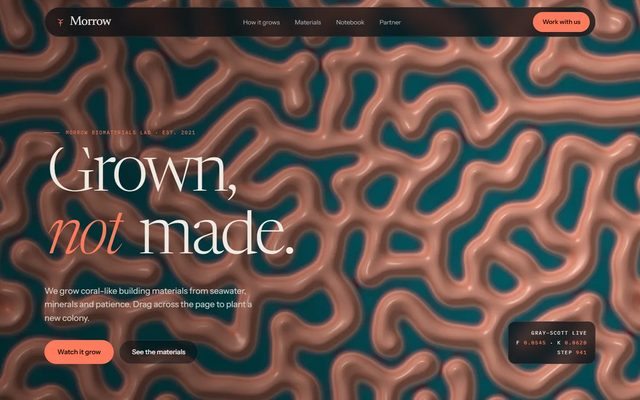</a><br><b>Morrow</b> · a live reaction-diffusion coral lab</td>
</tr>
<tr>
<td width="33%" valign="top"><a href="https://animatedwebs.com/templates/rheotype-liquid-type-foundry">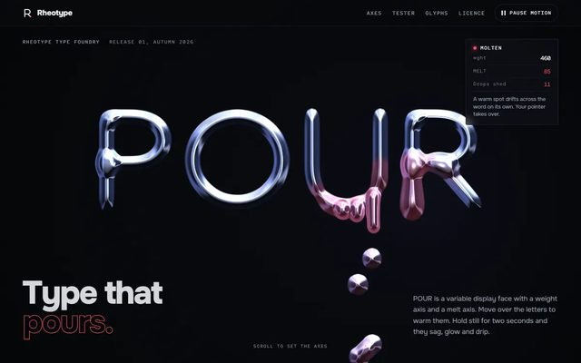</a><br><b>Rheotype</b> · chrome letters that swell, sag and drip</td>
<td width="33%" valign="top"><a href="https://animatedwebs.com/templates/glasshour-nightclub">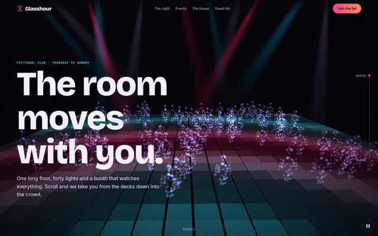</a><br><b>Glasshour</b> · beams sweep haze over a particle crowd</td>
<td width="33%" valign="top"><a href="https://animatedwebs.com/templates/valkyrie-orbital-mach9"></a><br><b>Valkyrie</b> · a spaceplane climbs to orbit as you scroll</td>
</tr>
</table>

<div align="center">

**[See all 1,500+ templates on AnimatedWebs](https://animatedwebs.com/templates)**

</div>

## FAQ

**Is it free?**
Yes. The skills and scripts are MIT licensed. The four templates are free for personal, commercial and client sites under [their own license](templates/LICENSE.md), which only asks that you do not resell them as templates.

**Do I need Claude Code?**
No. Claude Code gets a one-command install, but every skill is a plain folder of Markdown and scripts. Codex, Cursor, Windsurf, Antigravity and other agents can read them, see [manual copy](#codex-cursor-and-any-other-agent-manual-copy).

**Do I need an AnimatedWebs account?**
Not for the skills, the scripts or the four templates. The AnimatedWebs MCP and template prompts need a free account, and Pro unlocks the full catalog.

**Why vanilla JavaScript and no build step?**
Agents read and edit plain modules reliably, readers can copy a snippet into any stack, and a page that runs from a folder is easy to review. The recipes port cleanly to React, Vue, Svelte or React Three Fiber, and GSAP or Lenis can be added when a recipe calls for them.

**Does it work on phones?**
Phones come first. Every recipe has phone notes, the review scores the phone experience before the desktop, and the QA script fails any page with text under 11 px, tap targets under 44 px or horizontal scroll at 390 px wide.

**What about accessibility and motion sickness?**
Built in, not bolted on. Any motion longer than five seconds needs a visible pause control, every page needs a complete `prefers-reduced-motion` branch, scroll is never hijacked, and content lives in real HTML with a no-WebGL fallback.

**Will my agent copy someone else's site?**
No. The skills tell the agent to study ideas and write its own code, use fictional brands in demos, and never copy code, text, assets or hero concepts from a reference site.

**How is this different from a prompt library?**
A prompt describes one page. These skills teach the process that produces good pages and check the result with screenshots, a rubric and measured numbers.

## Roadmap

- [x] v1.0: three skills, 26 technique recipes, four scripts, four free templates
- [ ] More recipes: page transitions, GPU particle systems, kinetic type
- [ ] A GitHub Action wrapper for `qa-lite.mjs` so pull requests fail on blocking checks
- [ ] Recipe ports for React Three Fiber
- [ ] More free templates, released alongside new AnimatedWebs drops

Ideas and requests are welcome in [Issues](https://github.com/iboss21/regescore-motioncraft-skills/issues).

## Contributing

New recipes, sharper rules, script fixes and better checks are all welcome. Please read [CONTRIBUTING.md](CONTRIBUTING.md) first: it covers the recipe format, house style and how to test. Security issues go through [SECURITY.md](SECURITY.md), not public issues.

## The LIKE A KING INC. ecosystem

MotionCraft Skills is published by [LIKE A KING INC.](https://likeakinginc.com), a New York company that builds AI products, developer tools and motion design platforms. Here is the whole family. The full map with notes is in [docs/ecosystem.md](docs/ecosystem.md).

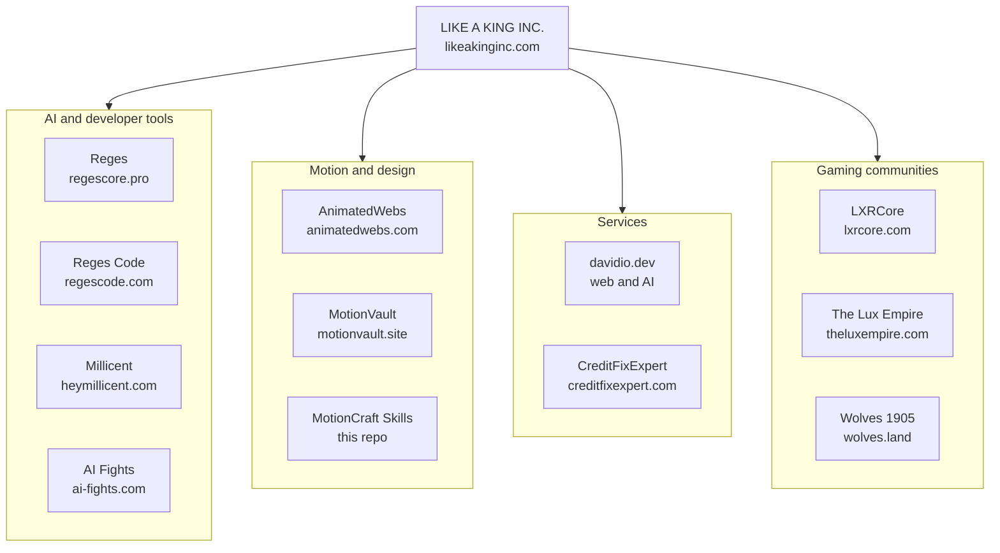

| Group | Project | What it is |
|---|---|---|
| Company | [LIKE A KING INC.](https://likeakinginc.com) | AI engineering, cloud and security |
| AI and developer tools | [Reges](https://regescore.pro) | Private, local-first AI |
| | [Reges Code](https://regescode.com) | The AI code editor |
| | [Millicent](https://heymillicent.com) | AI sidekick for Discord |
| | [AI Fights](https://ai-fights.com) | Two minds, one arena (coming soon) |
| Motion and design | [AnimatedWebs](https://animatedwebs.com) | Motion website templates with live demos and build prompts |
| | [MotionVault](https://motionvault.site) | Cinematic motion and films |
| Services | [davidio.dev](https://davidio.dev) | Web development and AI integrations |
| | [CreditFixExpert](https://creditfixexpert.com) | Credit report checks |
| Gaming communities | [LXRCore](https://lxrcore.com) | FiveM and RedM server resources |
| | [The Lux Empire](https://theluxempire.com) | FiveM roleplay community |
| | [Wolves 1905](https://wolves.land) | RedM roleplay community |

### Related open source

- [animatedwebs-claude](https://github.com/iboss21/animatedwebs-claude): the official AnimatedWebs plugin for Claude Code, with the MCP and site, hero and browse commands.
- [motionvault-agent-kit](https://github.com/iboss21/motionvault-agent-kit): the MotionVault MCP toolkit with skills and agent guides for cinematic websites.
- [video-shotcraft](https://github.com/iboss21/video-shotcraft): an AI video skill for cinematic product videos with Remotion, with shot recipe cards and a production template.

## License

The skills, references and scripts are released under the [MIT License](LICENSE), Copyright (c) 2026 LIKE A KING INC. The free templates in [`templates/`](templates/) are covered by [templates/LICENSE.md](templates/LICENSE.md). AnimatedWebs, MotionVault and Reges are products of LIKE A KING INC. The MIT license covers the code and text in this repository, not the product names or logos.

<div align="center">

<br>

Made by [LIKE A KING INC.](https://likeakinginc.com) · [AnimatedWebs](https://animatedwebs.com) · [Templates](https://animatedwebs.com/templates) · [MCP](https://animatedwebs.com/mcp)

If MotionCraft helps you ship something you are proud of, a star helps other builders find it.

</div>
