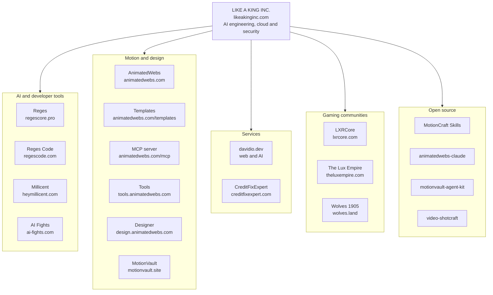

# The LIKE A KING INC. ecosystem

[LIKE A KING INC.](https://likeakinginc.com) is a New York company that builds AI products, developer tools, motion design platforms and online communities. MotionCraft Skills is one of its open source projects. This page maps the whole family, one line per project.

## Map

## Company

| Project | What it is |
|---|---|
| [LIKE A KING INC.](https://likeakinginc.com) | AI engineering, cloud and security |

## AI and developer tools

| Project | What it is |
|---|---|
| [Reges](https://regescore.pro) | Private, local-first AI |
| [Reges Code](https://regescode.com) | The AI code editor |
| [Millicent](https://heymillicent.com) | AI sidekick for Discord |
| [AI Fights](https://ai-fights.com) | Two minds, one arena (coming soon) |

## Motion and design

| Project | What it is |
|---|---|
| [AnimatedWebs](https://animatedwebs.com) | Motion website templates with live demos and build prompts |
| [MotionVault](https://motionvault.site) | Cinematic motion and films |

AnimatedWebs has four surfaces you can use today:

| Surface | What it is |
|---|---|
| [Templates](https://animatedwebs.com/templates) | 1,500+ motion website templates with live demos and build prompts |
| [MCP server](https://animatedwebs.com/mcp) | Templates, components, backgrounds and style references inside your AI editor |
| [Tools](https://tools.animatedwebs.com) | three.js hero components and interactive shaders with tunable variants |
| [Designer](https://design.animatedwebs.com) | A private design workspace with AnimatedWebs AI |

Setup for each editor is in [tools/README.md](../tools/README.md).

## Services

| Project | What it is |
|---|---|
| [davidio.dev](https://davidio.dev) | Web development and AI integrations |
| [CreditFixExpert](https://creditfixexpert.com) | Credit report checks |

## Gaming communities

| Project | What it is |
|---|---|
| [LXRCore](https://lxrcore.com) | FiveM and RedM server resources |
| [The Lux Empire](https://theluxempire.com) | FiveM roleplay community |
| [Wolves 1905](https://wolves.land) | RedM roleplay community |

## Open source

| Repository | What it is |
|---|---|
| [regescore-motioncraft-skills](https://github.com/iboss21/regescore-motioncraft-skills) | This repository: skills to build, review and measure cinematic motion websites |
| [animatedwebs-claude](https://github.com/iboss21/animatedwebs-claude) | The official AnimatedWebs plugin for Claude Code |
| [motionvault-agent-kit](https://github.com/iboss21/motionvault-agent-kit) | The MotionVault MCP toolkit with skills and agent guides |
| [video-shotcraft](https://github.com/iboss21/video-shotcraft) | An AI video skill for cinematic product videos with Remotion |

More public work lives on [github.com/iboss21](https://github.com/iboss21).

## How the motion pieces fit together

- **MotionCraft Skills** (this repo) teach the method: one idea, a beat sheet, a grey-boxed mechanic, then review and measurement.
- **AnimatedWebs** is where that method ships as templates you can play, with build prompts for your own projects.
- **The AnimatedWebs MCP** and the **animatedwebs-claude** plugin bring those templates into Claude Code, Cursor, Codex and other editors.
- **Reges Code** comes with the AnimatedWebs MCP already set up.
- **MotionVault** and **motionvault-agent-kit** cover cinematic motion and films.
- **video-shotcraft** brings the same shot-by-shot planning to product videos made with Remotion.

---

Back to the [main README](../README.md)
