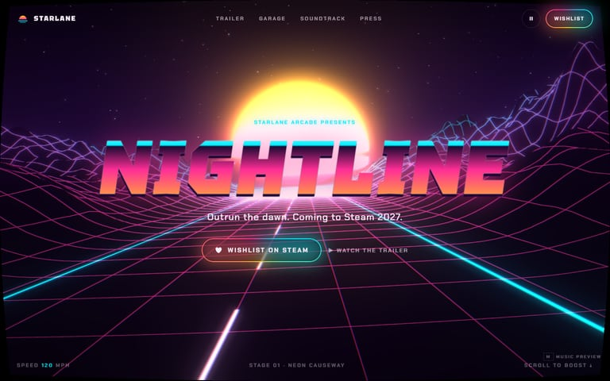
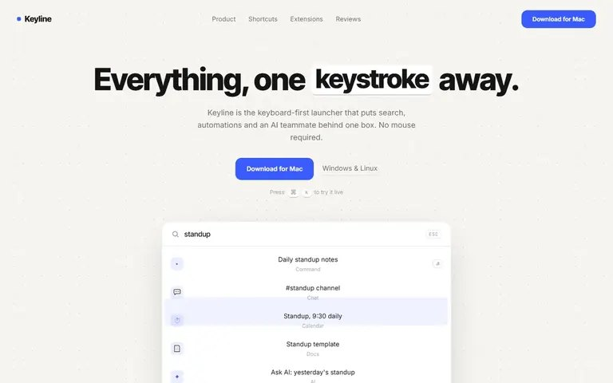
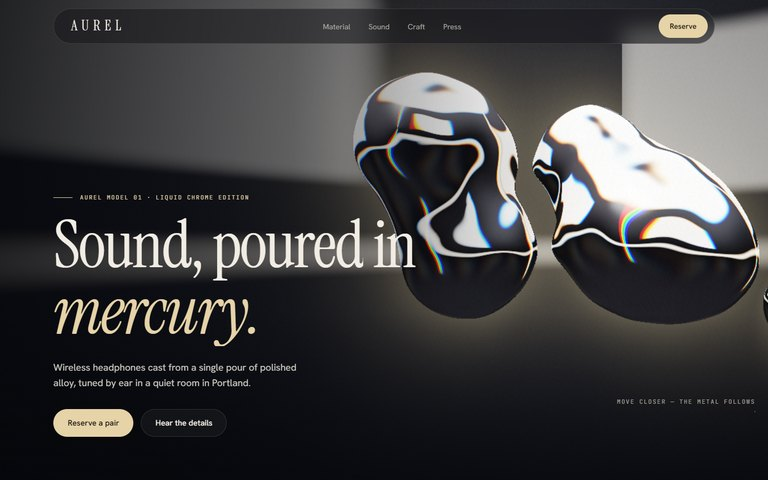
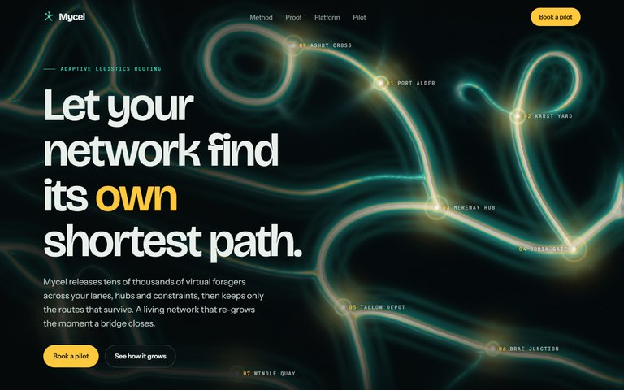

# Free templates

Four complete motion websites from the [AnimatedWebs](https://animatedwebs.com) catalog, free to use on your own and client sites. Each one is a full page (navigation, content sections, calls to action, footer) built around a single signature motion idea, and each one is a single `index.html` with no build step.

<table>
  <tr>
    <td width="50%" valign="top">
      <a href="starlane-synthwave-terrain/"></a>
      <br><b><a href="starlane-synthwave-terrain/">Starlane Synthwave Terrain</a></b>
      <br>Game launch page. A three.js wireframe valley rushes toward a banded sun, and scroll speed is the throttle. Bloom plus a CRT pass.
      <br><a href="https://animatedwebs.com/demos/starlane-synthwave-terrain/">Live demo</a> · <a href="https://animatedwebs.com/templates/starlane-synthwave-terrain">Template page</a>
    </td>
    <td width="50%" valign="top">
      <a href="keyline-command-palette-home/"></a>
      <br><b><a href="keyline-command-palette-home/">Keyline Command Palette Home</a></b>
      <br>SaaS home page. A command palette demos itself, then hands control to the visitor on Cmd+K. Keystrokes ripple through a dot grid.
      <br><a href="https://animatedwebs.com/demos/keyline-command-palette-home/">Live demo</a> · <a href="https://animatedwebs.com/templates/keyline-command-palette-home">Template page</a>
    </td>
  </tr>
  <tr>
    <td width="50%" valign="top">
      <a href="aurel-liquid-chrome-audio/"></a>
      <br><b><a href="aurel-liquid-chrome-audio/">Aurel Liquid Chrome Audio</a></b>
      <br>Product page. Raymarched liquid chrome follows the cursor, splashes on click and pours together on scroll. Adaptive resolution.
      <br><a href="https://animatedwebs.com/demos/aurel-liquid-chrome-audio/">Live demo</a> · <a href="https://animatedwebs.com/templates/aurel-liquid-chrome-audio">Template page</a>
    </td>
    <td width="50%" valign="top">
      <a href="mycel-physarum-network/"></a>
      <br><b><a href="mycel-physarum-network/">Mycel Physarum Network</a></b>
      <br>Platform home page. A GPU slime mold simulation grows routes between hubs, and visitors can feed it or plant new hubs.
      <br><a href="https://animatedwebs.com/demos/mycel-physarum-network/">Live demo</a> · <a href="https://animatedwebs.com/templates/mycel-physarum-network">Template page</a>
    </td>
  </tr>
</table>

| Template | Rendering | Libraries | Weight |
| --- | --- | --- | --- |
| [Starlane Synthwave Terrain](starlane-synthwave-terrain/) | three.js scene, bloom, custom CRT pass | three.js 0.170 (CDN, import map) | about 44 KB of HTML |
| [Keyline Command Palette Home](keyline-command-palette-home/) | DOM plus Canvas 2D | none | about 33 KB of HTML |
| [Aurel Liquid Chrome Audio](aurel-liquid-chrome-audio/) | raw WebGL2 raymarching | none | about 32 KB of HTML |
| [Mycel Physarum Network](mycel-physarum-network/) | WebGL2 agent simulation, Canvas 2D fallback | none | about 53 KB of HTML |

All four load fonts from Google Fonts. No analytics, no trackers, no external calls beyond fonts and the three.js CDN.

## Run any template

```bash
cd templates/aurel-liquid-chrome-audio
python -m http.server 8080
# open http://localhost:8080
```

Any static server works (`npx serve`, VS Code Live Server, your host of choice). Opening `index.html` straight from disk also works in current browsers. To ship, upload the folder to any static host.

## The bar they were built to

These pages follow the same rules the [MotionCraft skills](../plugins/motioncraft/) teach:

- **One signature motion per page**, tied to the product story, not decoration layered on top.
- **A visible pause control.** One button in the nav stops every continuous loop, canvas and CSS alike, and keeps the page composed.
- **A real reduced motion path.** With `prefers-reduced-motion` each page shows a finished still frame instead of an empty canvas.
- **Nothing runs unseen.** Canvases pause when off screen or when the tab is hidden.
- **Phones are a first class target.** Pixel ratio caps, lighter simulations, smaller effects and their own layouts.
- **Graceful fallbacks.** If WebGL is missing the page still reads and looks intentional.
- **Readable and usable.** Real headings, labeled form fields, keyboard access, visible focus and 44 px tap targets on phones.
- **Reveals run both ways.** Section reveals are a pure function of scroll position, so scrolling back up undoes them cleanly.
- **Checked, not assumed.** All four pass the 12 blocking checks of [`qa-lite.mjs`](../plugins/motioncraft/skills/motion-review/scripts/qa-lite.mjs) at 1440x900 and 390x844.

## Use them with an AI agent

- Install the MotionCraft plugin from this repo, then ask your agent to rebrand a template, for example: "Rebrand templates/aurel-liquid-chrome-audio for a coffee roaster in Seattle. Keep the liquid chrome hero, swap the gold accent for copper, rewrite the copy, then run a motion review." The [builder](../plugins/motioncraft/skills/motioncraft-builder/), [review](../plugins/motioncraft/skills/motion-review/) and [analytics](../plugins/motioncraft/skills/motion-analytics/) skills cover the build, the QA pass and the performance check.
- The [AnimatedWebs MCP server](https://animatedwebs.com/mcp) lets MCP clients such as Claude Code and Cursor search the full catalog.

## More templates

More free and Pro motion templates, from WebGL heroes to cinematic scroll films, live at [animatedwebs.com/templates](https://animatedwebs.com/templates).

## License

Free for personal and commercial websites, including client work. You may not resell or redistribute the templates as templates or in a template collection. See [LICENSE.md](LICENSE.md). Copyright 2026 LIKE A KING INC.
